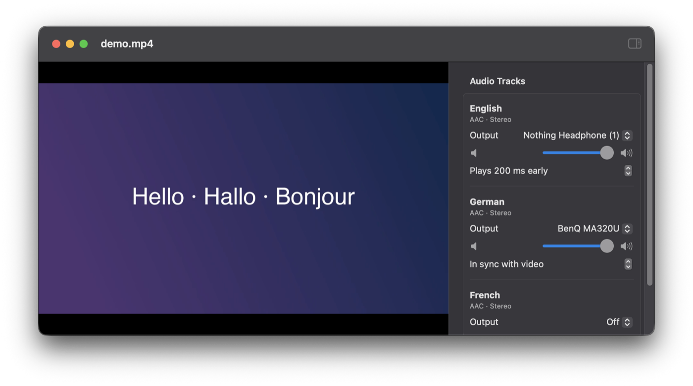

# Polyglot

A small macOS video player that plays several audio tracks of the same video **at the same time, each on its own output device**.

Example: the video and its German audio play on the TV, while the English audio plays on your headphones, in sync and paused and seeked together.

Typical players (VLC, QuickTime, IINA, mpv) play one audio track at a time, to one device. Polyglot is built for households where people want to watch together in different languages.



## Features

- Pick an output for every audio track: off, system default, or any connected device
- Any number of tracks at once (e.g. three languages on three devices)
- Pause, seek and playback speed apply to all tracks
- Per-device latency compensation: play a device early if it lags (Bluetooth headphones, ~150–250 ms; 200 ms is the default for Bluetooth) or late if it runs ahead
- Per-track volume; the player's own volume control acts as master volume
- Remembers which language goes to which device, and each device's latency setting
- Opens MP4 and MOV directly, and MKV after a quick automatic conversion (see [File formats](#file-formats))

## Download

Get `Polyglot.zip` from the [latest release](../../releases/latest), unzip it and move `Polyglot.app` to Applications. Requires macOS 14 or later, on Apple Silicon or Intel.

### First launch

Polyglot is not notarized by Apple (that needs a paid developer account), so macOS blocks it the first time:

1. Open Polyglot. macOS says it can't verify the app; click **Done**.
2. Open **System Settings → Privacy & Security**, scroll down, and click **Open Anyway** next to the Polyglot message.
3. Open Polyglot again and confirm.

Or, in Terminal: `xattr -dr com.apple.quarantine /Applications/Polyglot.app`

## Usage

Open a file with ⌘O, by dropping it on the window, or with *Open With → Polyglot*. Playback starts right away. In the sidebar, choose an output for each audio track. Use the toolbar button to show or hide the sidebar.

To line up a device, watch someone speak and adjust its latency until lips and voice match. `scripts/make-test-video.sh` creates a clip that beeps once per second with an on-screen timer, which makes this easier.

## File formats

Polyglot plays local files only. It is meant for videos you own or have the rights to watch, such as your own recordings or personal copies of discs you bought.

Polyglot uses Apple's AVFoundation, which plays MP4/MOV files with H.264 or HEVC video and AAC, AC-3, E-AC-3, ALAC or MP3 audio.

**MKV and other formats** that macOS can't open are converted to MP4 automatically when you open them. This needs [ffmpeg](https://ffmpeg.org) (`brew install ffmpeg`). The video is copied, not re-encoded, so converting a feature film takes seconds. The three most recently converted files are kept in `~/Library/Caches/io.github.jcsrb.polyglot`, so reopening one is instant. To convert by hand instead: `scripts/to-mp4.sh movie.mkv`.

Audio formats macOS can't play (DTS, DTS-HD, TrueHD, Opus, FLAC) are converted to AAC. Subtitles are not kept. Notes on reading MKV natively are in [docs/mkv-support.md](docs/mkv-support.md).

## FAQ

**Why not two VLC windows, or a macOS Aggregate Device?**
Two players on different devices drift apart and don't pause or seek together. An Aggregate Device keeps sync, but needs a remuxed multi-channel file and manual setup in Audio MIDI Setup, and Bluetooth headphones don't behave well in one.

**iPhone, iPad or Apple TV version?**
Not possible: iOS and tvOS let an app play audio to only one output at a time.

**Windows or Linux?**
Not yet, but both platforms can do it, and contributions are very welcome. [docs/other-platforms.md](docs/other-platforms.md) has the APIs, starting sketches and a test plan.

**Subtitles?**
Not yet. With everyone on their own audio track they matter less, and disc subtitles (PGS, VobSub) are images that AVFoundation can't show.

## Build from source

Requires Xcode or the Swift toolchain (Swift 5.10 or later).

```bash
swift run Polyglot path/to/video.mp4     # run directly
scripts/build-app.sh                      # build build/Polyglot.app (UNIVERSAL=1 for Apple Silicon + Intel)
```

## How it works

The video plays in a silent `AVPlayer` that acts as the master clock. Each audio track gets its own audio-only `AVPlayer`, routed with `audioOutputDeviceUniqueID`. All players run on the host clock. On play, seek and pause, each audio player is scheduled with `setRate(_:time:atHostTime:)` to start exactly where the video will be, shifted by its device's latency offset. A drift check every 0.5 s resyncs any track that is more than 40 ms off.

Set `POLYGLOT_DEBUG=1` to log the measured drift per track.

## Limitations

- Bluetooth latency varies by headphones and has to be tuned by ear once per device.
- One file at a time; no playlists, subtitles, or resume position yet.

## License

[MIT](LICENSE)
